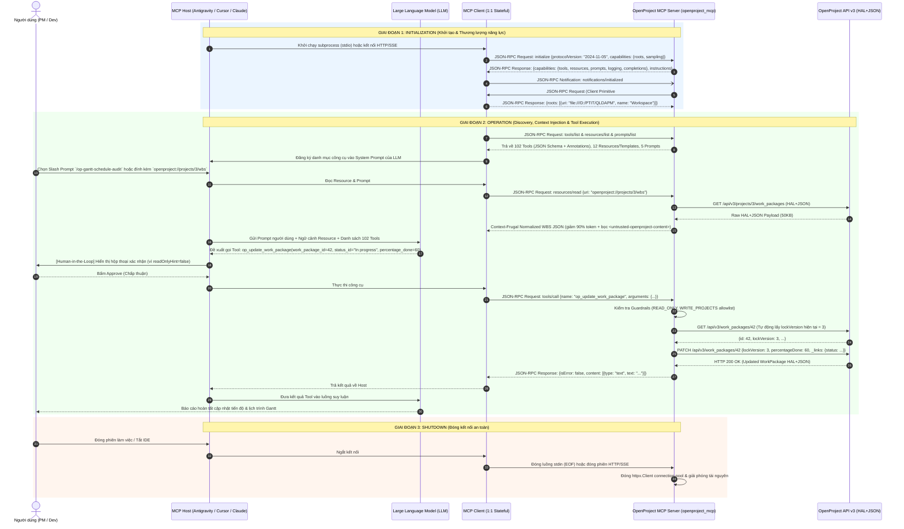

# OpenProject Enterprise MCP Server (`openproject_mcp` v2.0)

Hệ thống **Model Context Protocol (MCP) Server** hoàn chỉnh cấp độ Production dành cho **OpenProject (Community & Enterprise Edition — REST API v3 `application/hal+json`)**, được thiết kế tổng hợp từ chuẩn MCP chính thức của Anthropic, kiến trúc built-in `/mcp` của OpenProject 16/17+ và các hệ thống mã nguồn mở hàng đầu trên GitHub (`jtauschl/openproject-ce-mcp`, `AndyEverything/openproject-mcp-server`, `jessebautista/mcp-openproject-smithery`).

---

## 1. Mô phỏng Kiến trúc & Luồng hoạt động MCP (JSON-RPC 2.0 Sequence Diagram)

Sơ đồ tương tác dưới đây minh họa chi tiết từng bản tin **JSON-RPC 2.0** di chuyển giữa **MCP Host**, **MCP Client**, **LLM**, **OpenProject MCP Server** và **OpenProject REST API v3** trong suốt 3 giai đoạn vòng đời kết nối:



---

## 2. Kiến trúc Module của Hệ thống (`openproject_mcp`)

```text
openproject_mcp/
├── __init__.py                         # Metadata & Package Exports
├── __main__.py                         # CLI Entrypoint (python -m openproject_mcp)
├── config.py                           # Cấu hình .env & Chính sách bảo mật (Allowlists, Read-Only, Guards)
├── hal_normalizer.py                   # Bộ nén HAL+JSON (-90% token), chuyển đổi ISO-8601 Duration & Chống Prompt Injection
├── client.py                           # HTTP Client (Connection Pool, Auto-Retry, Auto-lockVersion 409, Form Validator)
├── registry.py                         # Tool Registry kèm MCP Tool Annotations (readOnlyHint, destructiveHint, idempotentHint)
├── resources.py                        # MCP Primitive #2: 7 Static Resources & 5 Dynamic URI Templates (openproject://)
├── prompts.py                          # MCP Primitive #3: 5 Standardized PM/Agile/WBS/Gantt/EVM Slash Prompts
├── server.py                           # MCP JSON-RPC 2.0 Engine (stdio + Streamable HTTP/SSE + Sampling #4 + Roots #5)
├── test_mcp_protocol.py                # Bộ kiểm thử tự động toàn diện giao thức MCP & HAL Normalizer
└── domains/                            # 102 Tools chia thành 10 Module nghiệp vụ chuyên sâu
    ├── system_and_metadata.py          # Chẩn đoán Doctor, Instance Config, Statuses, Types, Priorities, Roles, Schemas, Days
    ├── projects.py                     # CRUD Projects, Copy/Clone Project Template, Assignable Users
    ├── work_packages.py                # CRUD Work Packages, Form Validation, Subtasks, Bulk Create WBS, Bulk Update, Revisions
    ├── relations_and_gantt.py          # CRUD Relations, FS Dependency Chain Builder, Gantt Critical Path Method (CPM) Engine
    ├── versions_and_categories.py      # CRUD Versions (Sprints/Releases) + Sprint Progress Summary & Categories
    ├── comments_watchers_attachments.py# Activities/Comments, Watchers, Multipart File Attachment Upload/Delete
    ├── time_and_budgets.py             # Time Entries (Decimal Hours <-> ISO-8601), Timesheet Aggregator, Budgets
    ├── users_memberships_groups.py     # Users, Project Memberships, Groups, Principals, Placeholder Users
    ├── queries_wiki_collab.py          # Saved Queries (Gantt/Board Views), Wiki, News, Documents, Meetings, Grids, Notifications
    └── analytics_evm_agile.py          # Earned Value Management (EVM), WBS 100% Rule Auditor, Team Workload, KPI Scorecard
```

---

## 3. Danh mục 102 MCP Tools theo 12 Nhóm Nghiệp vụ

| Nhóm (Domain) | Số lượng | Các Tool tiêu biểu |
| :--- | :---: | :--- |
| **1. `system`** | 4 | `op_doctor_check`, `op_get_instance_configuration`, `op_get_current_user`, `op_render_markdown` |
| **2. `metadata`** | 11 | `op_list_statuses`, `op_get_status`, `op_list_types`, `op_get_type`, `op_list_priorities`, `op_list_time_entry_activities`, `op_list_roles`, `op_get_work_package_schema`, `op_get_custom_option`, `op_list_working_days_and_holidays`, `op_list_help_texts` |
| **3. `projects`** | 7 | `op_list_projects`, `op_get_project`, `op_create_project`, `op_update_project`, `op_copy_project`, `op_delete_project`, `op_list_project_assignable_users` |
| **4. `work_packages`** | 12 | `op_list_work_packages`, `op_get_work_package`, `op_validate_work_package_form`, `op_create_work_package`, `op_update_work_package`, `op_delete_work_package`, `op_list_subtasks`, `op_bulk_create_work_packages`, `op_bulk_update_work_packages`, `op_execute_custom_action`, `op_list_work_package_revisions`, `op_list_work_package_file_links` |
| **5. `relations_gantt`** | 6 | `op_list_relations`, `op_create_relation`, `op_update_relation`, `op_delete_relation`, `op_create_dependency_chain`, `op_analyze_gantt_critical_path` |
| **6. `versions_categories`** | 8 | `op_list_versions`, `op_get_version`, `op_create_version`, `op_update_version`, `op_delete_version`, `op_list_categories`, `op_create_category`, `op_delete_category` |
| **7. `collaboration`** | 9 | `op_list_work_package_activities`, `op_add_work_package_comment`, `op_update_comment`, `op_list_watchers`, `op_add_watcher`, `op_remove_watcher`, `op_list_attachments`, `op_upload_attachment`, `op_delete_attachment` |
| **8. `time_budgets`** | 8 | `op_list_time_entries`, `op_get_time_entry`, `op_log_time_entry`, `op_update_time_entry`, `op_delete_time_entry`, `op_summarize_time_report`, `op_list_budgets`, `op_get_budget` |
| **9. `users_memberships`** | 9 | `op_list_users`, `op_get_user`, `op_list_memberships`, `op_create_membership`, `op_update_membership`, `op_delete_membership`, `op_list_groups`, `op_list_principals`, `op_list_placeholder_users` |
| **10. `admin`** | 9 | `op_create_user`, `op_update_user`, `op_lock_unlock_user`, `op_delete_user`, `op_create_group`, `op_update_group`, `op_delete_group`, `op_create_placeholder_user`, `op_delete_placeholder_user` |
| **11. `queries_collab`** | 15 | `op_list_queries`, `op_get_query`, `op_create_query`, `op_update_query`, `op_delete_query`, `op_get_wiki_page`, `op_list_news`, `op_create_news`, `op_update_news`, `op_delete_news`, `op_list_documents`, `op_list_meetings`, `op_list_grids`, `op_list_notifications`, `op_mark_notification_read` |
| **12. `pm_analytics`** | 4 | `op_analyze_project_evm`, `op_generate_wbs_tree`, `op_analyze_team_workload`, `op_analyze_member_kpi_scorecard` |

---

## 4. Hướng dẫn Khởi chạy & Cấu hình vào MCP Host

### Kiểm tra danh mục & Chẩn đoán kết nối (`--catalog` & `--doctor`)

```powershell
# Xem toàn bộ 102 Tools, Resources và Prompts
python -m openproject_mcp --catalog

# Kiểm tra kết nối thực tế tới OpenProject API v3
python -m openproject_mcp --doctor

# Chạy bộ kiểm thử tự động
python -m unittest openproject_mcp/test_mcp_protocol.py -v
```

### Cấu hình cho Claude Desktop / Cursor / Antigravity IDE (`stdio`)

```json
{
  "mcpServers": {
    "openproject": {
      "command": "python",
      "args": ["-m", "openproject_mcp", "--transport", "stdio"],
      "cwd": "D:/PTIT/QLDAPM",
      "env": {
        "OPENPROJECT_URL": "http://26.65.103.140",
        "OPENPROJECT_API_KEY": "your_openproject_api_key_here",
        "OPENPROJECT_PROJECT_ID": "3",
        "OPENPROJECT_READ_ONLY": "false",
        "OPENPROJECT_ENABLE_DELETE_TOOLS": "true",
        "OPENPROJECT_SANITIZE_UNTRUSTED": "true"
      }
    }
  }
}
```

### Chạy ở chế độ Remote Server (`Streamable HTTP + SSE`)

```powershell
python -m openproject_mcp --transport http --host 0.0.0.0 --port 8765
```
* **Streamable HTTP Endpoint:** `POST http://localhost:8765/mcp`
* **SSE Endpoint:** `GET http://localhost:8765/sse` & `POST http://localhost:8765/messages`
* **Health Check:** `GET http://localhost:8765/health`
