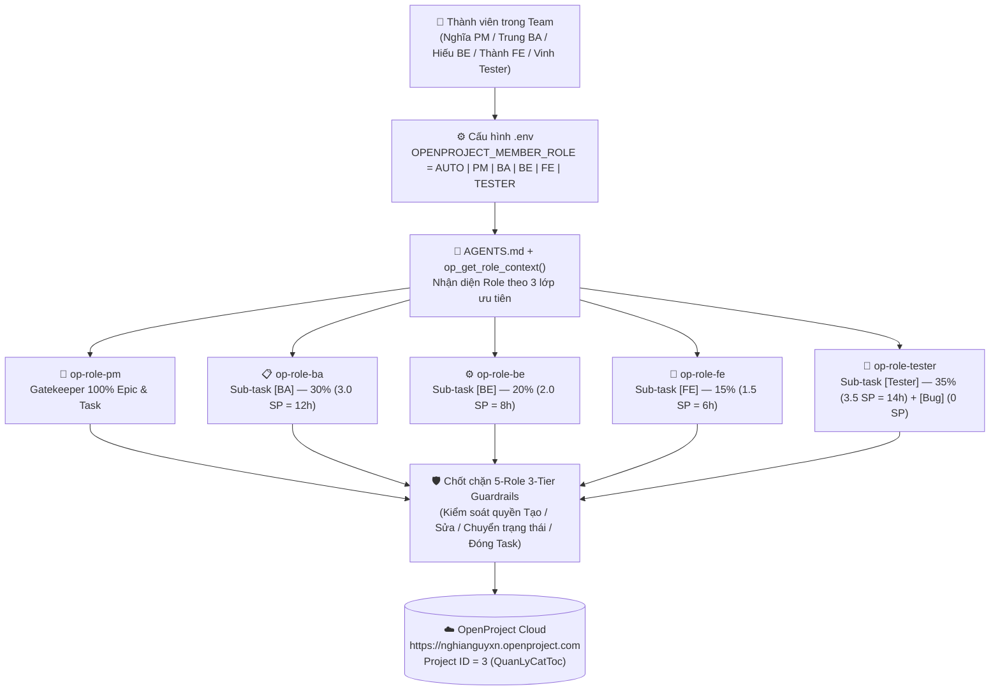

# CẨM NANG HƯỚNG DẪN SỬ DỤNG OPENPROJECT MCP & BỘ 5 KỸ NĂNG VAI TRÒ (`Role Skills`) CHO TEAM `QuanLyCatToc`

> **Tài liệu hướng dẫn thực chiến dành cho 5 thành viên dự án Quản Lý Cắt Tóc (`Project ID = 3` trên OpenProject Cloud `https://nghianguyxn.openproject.com`)**  
> *(Tra cứu chi tiết toàn bộ 106 hàm MCP Tools tại: [`openproject_mcp/HUONG_DAN_TOAN_TAP_OPENPROJECT_MCP_CHO_TEAM.md`](file:///D:/PTIT/QLDAPM/openproject_mcp/HUONG_DAN_TOAN_TAP_OPENPROJECT_MCP_CHO_TEAM.md))*

---

## 1. Tổng Quan Kiến Trúc Điều Phối 5 Vai Trò (`Role Dispatcher`)

Khi bất kỳ thành viên nào mở dự án `D:\PTIT\QLDAPM` trên **Antigravity IDE / Cursor / Claude Desktop**, hệ thống sẽ tự động kết nối tới **OpenProject Cloud (`https://nghianguyxn.openproject.com`)** thông qua **`openproject_mcp` (106 Tools)** và điều phối hành vi của AI theo đúng vai trò của người đó:



### Bảng Định Danh 5 Thành Viên & Kỹ Năng Điều Phối (`SKILL.md`)

| Mã Role (`OPENPROJECT_MEMBER_ROLE`) | Thành viên phụ trách | `user_id` | Email đăng nhập OpenProject Cloud | Tiền tố & Tỷ trọng chuẩn (`30-20-15-35`) | File Kỹ năng AI (`SKILL.md`) |
| :---: | :--- | :---: | :--- | :--- | :--- |
| **`PM`** | **Nguyễn Trung Nghĩa** | `4` | `nghia2592005@gmail.com` | `[PM]` — **Sole Gatekeeper & Owner 100% `Epic` / `Task`** | [`.agents/skills/op-role-pm/SKILL.md`](file:///D:/PTIT/QLDAPM/.agents/skills/op-role-pm/SKILL.md) |
| **`BA`** | **Nguyễn Vĩnh Trung** | `5` | `nguyenvinhtrung0509@gmail.com` | `[BA]` — **`30%`** (`3.0 SP` = `12h` / màn hình) | [`.agents/skills/op-role-ba/SKILL.md`](file:///D:/PTIT/QLDAPM/.agents/skills/op-role-ba/SKILL.md) |
| **`BE`** | **Vũ Quốc Hiếu** | `6` | `hieubao189@gmail.com` | `[BE]` — **`20%`** (`2.0 SP` = `8h` / màn hình) | [`.agents/skills/op-role-be/SKILL.md`](file:///D:/PTIT/QLDAPM/.agents/skills/op-role-be/SKILL.md) |
| **`FE`** | **Bùi Tuấn Thành** | `7` | `buituanthanh02@gmail.com` | `[FE]` — **`15%`** (`1.5 SP` = `6h` / màn hình) | [`.agents/skills/op-role-fe/SKILL.md`](file:///D:/PTIT/QLDAPM/.agents/skills/op-role-fe/SKILL.md) |
| **`TESTER`** | **Lương Duy Vinh** | `8` | `vinhluong2894@gmail.com` | `[Tester]` — **`35%`** (`3.5 SP` = `14h` / màn hình) + `[Bug]` (`0 SP`) | [`.agents/skills/op-role-tester/SKILL.md`](file:///D:/PTIT/QLDAPM/.agents/skills/op-role-tester/SKILL.md) |

---

## 2. Hướng Dẫn Cài Đặt Nhanh Trên Máy Mỗi Thành Viên (Chỉ 5 Phút)

### Bước 1: Cài đặt thư viện Python cần thiết
Mở PowerShell tại thư mục gốc `D:\PTIT\QLDAPM` (yêu cầu Python 3.10+) và chạy:

```powershell
pip install httpx pydantic python-dotenv requests
```

### Bước 2: Lấy mã `OPENPROJECT_API_KEY` cá nhân trên OpenProject Cloud
1. Đăng nhập vào **`https://nghianguyxn.openproject.com`** bằng email Gmail thật của bạn (xem bảng trên — không cần bật Radmin VPN).
2. Bấm vào **Ảnh đại diện (Avatar)** ở góc phải trên cùng $\rightarrow$ **My account**.
3. Chọn mục **Access tokens** ở menu trái $\rightarrow$ tại dòng **API**, bấm **`+ API token`** và copy mã token vừa sinh ra.

### Bước 3: Cấu hình file [`openproject_mcp/.env`](file:///D:/PTIT/QLDAPM/openproject_mcp/.env)
Copy file mẫu `openproject_mcp\.env.example` thành `openproject_mcp\.env` (hoặc mở trực tiếp `openproject_mcp\.env`) và điền:

```ini
OPENPROJECT_URL=https://nghianguyxn.openproject.com
OPENPROJECT_API_KEY=dán_mã_api_token_cá_nhân_của_bạn_vào_đây
OPENPROJECT_PROJECT_ID=3

# Để AUTO nếu bạn dùng API Key cá nhân (hệ thống tự nhận diện role qua /api/v3/users/me)
# Hoặc điền trực tiếp mã role của bạn: PM, BA, BE, FE, TESTER
OPENPROJECT_MEMBER_ROLE=AUTO

OPENPROJECT_READ_ONLY=false
OPENPROJECT_ENABLE_DELETE_TOOLS=true
OPENPROJECT_ENABLE_ADMIN_TOOLS=true
OPENPROJECT_SANITIZE_UNTRUSTED=true
OPENPROJECT_READ_PROJECTS=*
OPENPROJECT_WRITE_PROJECTS=*
```

### Bước 4: Kiểm tra kết nối & Role Context bằng lệnh `--doctor`
Mở PowerShell tại thư mục gốc `D:\PTIT\QLDAPM` và chạy:

```powershell
python -m openproject_mcp --doctor
```
Nếu thấy `"healthy": true` và `"activeRoleContext"` hiển thị đúng tên, email Gmail & vai trò của bạn trong `"memberProfile"` là đã thành công 100%!

### Bước 5: Tích hợp vào phần mềm AI (Antigravity IDE / Cursor / Claude Desktop)
Mở file cấu hình MCP của IDE (`mcp_config.json`, `.cursor/mcp.json`, hoặc `%APPDATA%\Claude\claude_desktop_config.json`) và thêm khối `"openproject"`:

```json
{
  "mcpServers": {
    "openproject": {
      "command": "python",
      "args": ["-m", "openproject_mcp", "--transport", "stdio"],
      "cwd": "D:/PTIT/QLDAPM",
      "env": {
        "OPENPROJECT_URL": "https://nghianguyxn.openproject.com",
        "OPENPROJECT_API_KEY": "dán_mã_api_token_cá_nhân_của_bạn_vào_đây",
        "OPENPROJECT_PROJECT_ID": "3",
        "OPENPROJECT_MEMBER_ROLE": "AUTO",
        "OPENPROJECT_READ_ONLY": "false",
        "OPENPROJECT_ENABLE_DELETE_TOOLS": "true",
        "OPENPROJECT_SANITIZE_UNTRUSTED": "true"
      }
    }
  }
}
```
Sau khi lưu file, bấm **Reload / Refresh MCP Server** trên IDE để nạp đủ **106 Tools**, **13 Resources** và **5 Prompts**.

---

## 3. Quy Chế WBS 3 Tầng, 10 Trạng Thái & Chốt Chặn Phân Quyền (`Role Guardrails`)

### 3.1. Ba Tầng Công Việc, 10 Trạng Thái Chuẩn & 3 Cổng Chốt Chặn (`Pre-Transition Child Gates`)
1. **Tầng 1 — `Epic` (`type_id = 5`):** 4 giai đoạn lớn của dự án (`Epic 1` $\rightarrow$ `Epic 4`).
   * **Luồng 4 trạng thái:** `READY` (`1`) $\rightarrow$ `In progress` (`7`) $\rightarrow$ **`In review` (`18`, dành riêng cho Epic)** $\rightarrow$ `Done` (`12`).
   * **Quy tắc độc quyền:** Chỉ **`PM` (`Nguyễn Trung Nghĩa`, `user_id=4`)** sở hữu (`Assignee = 4`), sửa thuộc tính và chuyển trạng thái. Không nhập `estimated_hours` trực tiếp lên Epic. Khi đóng sang `Done`, **Pre-Transition Gate 1** yêu cầu 100% `Task` con phải ở trạng thái `Done` (`12`).
2. **Tầng 2 — `Task` (`type_id = 1`):** Mỗi Task là 1 màn hình chức năng (`[Màn hình] ...`, chuẩn `10 SP` = `40h`) hoặc hạng mục quản trị/kiến trúc.
   * **Luồng 8 trạng thái:** `READY` (`1`) $\rightarrow$ `BA in progress` (`16`) $\rightarrow$ `BA Review` (`17`) $\rightarrow$ `Dev in progress` (`15`) $\rightarrow$ `Ready for test` (`10`) $\rightarrow$ `Testing` (`9`) $\leftrightarrow$ `Rework` (`14`) $\rightarrow$ `Done` (`12`).
   * **Quy tắc độc quyền:** **`PM` (`user_id=4`) là Owner duy nhất (`Assignee = 4`) và là thành viên duy nhất được phép sửa thuộc tính hoặc chuyển trạng thái `Task`.** Các thành viên `BA`, `BE`, `FE`, `TESTER` chỉ cập nhật `Sub-task` của mình và ghi **Comment Bàn Giao 3 Phần** (`op_add_work_package_comment`) lên `Task` cha để `PM` chuyển trạng thái `Task`.
   * **3 Cổng Chốt Chặn Trạng Thái Con (`Pre-Transition Child State Gates`):**
     * **Gate 3 (`BA Review` `17`):** Chặn chuyển `Task` sang `BA Review` nếu `Sub-task` `[BA]` chưa `Done` (`12`).
     * **Gate 2 (`Ready for test` `10`):** Chặn chuyển `Task` sang `Ready for test` nếu bất kỳ `Sub-task` `[BE]`, `[FE]` hoặc `[Bug]` nào dưới `Task` đó chưa `Done` (`12`).
     * **Gate 1 (`Done` `12`):** Chặn đóng `Task` (hoặc `Epic`) sang `Done` nếu còn bất kỳ `Sub-task` (`[BA]`, `[BE]`, `[FE]`, `[Tester]`, `[Bug]`) hoặc `Task` con nào chưa `Done` (`12`).
3. **Tầng 3 — `Sub-task` (`type_id = 8`):** Gồm 4 Sub-task chuyên môn dưới mỗi Task màn hình (`[BA]` 3 SP = 12h, `[BE]` 2 SP = 8h, `[FE]` 1.5 SP = 6h, `[Tester]` 3.5 SP = 14h) và các Sub-task `[Bug]` (`0 SP`).
   * **Luồng 3 trạng thái tinh gọn:** `READY` (`1`) $\rightarrow$ `In progress` (`7`) $\rightarrow$ `Done` (`12`) (kèm `Done` `12` $\rightarrow$ `In progress` `7` khi mở lại Sub-task để sửa SRS, Rework vá lỗi hoặc QA hậu kiểm).

### 3.2. Ma Trận Phân Quyền Theo Vai Trò (`Role Guardrails`)

| Thao tác trên OpenProject | `PM` (`4`) | `BA` (`5`) | `BE` (`6`) | `FE` (`7`) | `TESTER` (`8`) |
| :--- | :---: | :---: | :---: | :---: | :---: |
| **Tạo / Xóa `Epic` (`5`) & `Task` (`1`)** | ✅ Toàn quyền | ⛔ Chặn (`403`) | ⛔ Chặn (`403`) | ⛔ Chặn (`403`) | ⛔ Chặn (`403`) |
| **Sửa thuộc tính `Epic` (`5`) & `Task` (`1`)** | ✅ Toàn quyền | ⛔ Chặn (`403` — Chỉ ghi `comment` bàn giao) | ⛔ Chặn (`403` — Chỉ ghi `comment` bàn giao) | ⛔ Chặn (`403` — Chỉ ghi `comment` bàn giao) | ⛔ Chặn (`403` — Chỉ ghi `comment` bàn giao) |
| **Tạo `Sub-task` (`8`) dưới `Task` cha** | ✅ Toàn quyền | ✅ `[BA]` | ✅ `[BE]` | ✅ `[FE]` | ✅ `[Tester]` & `[Bug]` (`0 SP`, gán `BE`/`FE`) |
| **Chuyển trạng thái `Epic` (`5`)** | ✅ Toàn bộ luồng Epic (Gate 1: 100% Task con `Done`) | ⛔ Chặn (`403`) | ⛔ Chặn (`403`) | ⛔ Chặn (`403`) | ⛔ Chặn (`403`) |
| **Chuyển trạng thái `Task` (`1`)** | ✅ **Duy nhất** toàn bộ luồng 8 trạng thái Task (kèm Gate 1, Gate 2, Gate 3) | ⛔ Chặn (`403` — Ghi `comment` trên `Task` cha để `PM` chuyển trạng thái) | ⛔ Chặn (`403` — Ghi `comment` trên `Task` cha để `PM` chuyển trạng thái) | ⛔ Chặn (`403` — Ghi `comment` trên `Task` cha để `PM` chuyển trạng thái) | ⛔ Chặn (`403` — Ghi `comment` trên `Task` cha để `PM` chuyển trạng thái) |
| **Đóng `Epic` / `Task` sang `Done` (`12`)** | ✅ Duy nhất (`Approve & Close` / `Pass & Complete`, Gate 1) | ⛔ Chặn (`403`) | ⛔ Chặn (`403`) | ⛔ Chặn (`403`) | ⛔ Chặn (`403`) |
| **Chuyển trạng thái `Sub-task` (`8`)** | ✅ `READY -> In progress -> Done` & `Done -> In progress` | ✅ `READY -> In progress -> Done` & `Done -> In progress` (khi sửa SRS) | ✅ `READY -> In progress -> Done` & `Done -> In progress` (khi `Rework`) | ✅ `READY -> In progress -> Done` & `Done -> In progress` (khi `Rework`) | ✅ `READY -> In progress -> Done` + `Reopen` chéo (`Done -> In progress`) |

### 3.3. Định Tuyến Người Nhận Thông Minh (`Smart Assignee Resolution`) & Chuyển Đổi Vai Trò Nóng (`op_switch_role`)
* **Định tuyến `assignee_id` / `user_id` thông minh:** Trong các công cụ tìm kiếm, tạo/sửa công việc và chấm công giờ làm, bạn không cần nhớ ID số mà có thể truyền trực tiếp:
  * **`"me"` / `"tôi"`** (hoặc bật `only_my_tasks=True`): Tự động dịch sang `user_id` của Role đang active (`PM -> 4`, `BA -> 5`, `BE -> 6`, `FE -> 7`, `TESTER -> 8`).
  * **Mã vai trò:** `"PM"`, `"BA"`, `"BE"`, `"FE"`, `"TESTER"`, `"QA"`.
  * **Tên hoặc Email thành viên:** `"Nghĩa"`, `"Trung"`, `"Hiếu"`, `"Thành"`, `"Vinh"`, `"nguyenvinhtrung0509@gmail.com"`, `"hieubao189@gmail.com"`, `"buituanthanh02@gmail.com"`, `"vinhluong2894@gmail.com"`.
* **Chuyển đổi vai trò ngay trong khung chat (`op_switch_role`):** Khi cần đổi vai trò tạm thời trong phiên chat mà không muốn sửa file `.env`, chỉ cần nói: *"Chuyển sang role FE (Thành)"* $\rightarrow$ AI sẽ gọi `op_switch_role(role="FE")` và nạp ngay kỹ năng [`.agents/skills/op-role-fe/SKILL.md`](file:///D:/PTIT/QLDAPM/.agents/skills/op-role-fe/SKILL.md).

---

## 4. Kịch Bản Sử Dụng Hàng Ngày & Câu Lệnh Mẫu Cho Từng Thành Viên

### 👑 4.1. Vai trò `PM` — Nguyễn Trung Nghĩa (`user_id = 4`, Email: `nghia2592005@gmail.com`, Skill: `op-role-pm`)
1. **Kiểm tra công việc toàn nhóm trong ngày hôm nay:**
   ```text
   Kiểm tra role hiện tại của mình và liệt kê tất cả các công việc đang diễn ra trong ngày hôm nay (active_on_date="today") của dự án số 3.
   ```
2. **Phân rã màn hình mới thành 1 Task cha + 4 Sub-task con theo chuẩn `30-20-15-35`:**
   ```text
   Phân rã tính năng "[Màn hình] Quản lý Khuyến mãi & Voucher" thuộc Epic 4 thành 1 Task cha (10 SP, gán cho PM) và 4 Sub-task con theo tỷ lệ 30-20-15-35: [BA] (3 SP, 12h, giao Trung), [BE] (2 SP, 8h, giao Hiếu), [FE] (1.5 SP, 6h, giao Thành), [Tester] (3.5 SP, 14h, giao Vinh) rồi nối dây phụ thuộc Finish-to-Start tuần tự.
   ```
3. **Điều phối chuyển trạng thái `Task` cha theo báo cáo bàn giao của BA / BE / FE / Tester:**
   ```text
   Kiểm tra các Sub-task của Task #2545: nếu [BA] đã Done thì chuyển Task #2545 sang "BA Review" (hoặc duyệt luôn sang "Dev in progress"); nếu cả [BE], [FE] và [Bug] đã Done thì chuyển Task #2545 sang "Ready for test".
   ```
4. **Yêu cầu BA chỉnh sửa lại SRS (`Request SRS Fix`) hoặc kéo Task về `Rework` khi có `[Bug]`:**
   ```text
   Chuyển Task #2545 từ "BA Review" về lại "BA in progress" và ghi comment: "Nhờ Trung BA bổ sung thêm luồng xử lý khách hủy lịch sát giờ".
   ```
5. **Nghiệm thu & Đóng Task màn hình (`Pass & Complete` — Gate 1):**
   ```text
   Kiểm tra Task màn hình #2545 đang ở trạng thái "Testing" xem cả 4 Sub-task con và các [Bug] đã "Done" hết chưa. Nếu đã Done 100%, hãy nghiệm thu chuyển Task #2545 sang "Done" kèm comment bàn giao 3 phần.
   ```
6. **Xuất báo cáo Đường găng Gantt CPM, 12 chỉ số EVM & Bảng lương thưởng KPI:**
   ```text
   Phân tích Đường găng Gantt CPM, tính 12 chỉ số EVM (PV, EV, AC, CPI, SPI, EAC) và lập bảng điểm KPI chia quỹ thưởng 50.000.000 VNĐ cho 5 thành viên trong dự án số 3.
   ```

---

### 📋 4.2. Vai trò `BA` — Nguyễn Vĩnh Trung (`user_id = 5`, Email: `nguyenvinhtrung0509@gmail.com`, Skill: `op-role-ba`)
1. **Xem danh sách Sub-task `[BA]` của mình cần làm hôm nay:**
   ```text
   Mình là Trung BA. Hãy kiểm tra role của mình và liệt kê các Sub-task [BA] đang mở của mình trong dự án số 3, ưu tiên các việc đang diễn ra hôm nay.
   ```
2. **Bắt đầu phân tích 1 màn hình (`Start Work` trên Sub-task `[BA]` & báo PM):**
   ```text
   Mình bắt đầu phân tích màn hình #2545 (Sub-task [BA] #2546). Hãy chuyển Sub-task #2546 sang "In progress" (30%) và ghi comment bàn giao 3 phần vào Task màn hình cha #2545 báo PM Nghĩa chuyển Task #2545 từ "READY" sang "BA in progress".
   ```
3. **Hoàn tất SRS & Báo PM chuyển Task sang `BA Review` (`Submit SRS`):**
   ```text
   Mình đã hoàn thành đặc tả SRS và Wireframe cho Sub-task [BA] #2546. Hãy log 4 giờ làm việc hôm nay vào #2546, chuyển Sub-task #2546 sang "Done" (100%) và ghi comment bàn giao 3 phần vào Task màn hình cha #2545 đề nghị PM Nghĩa chuyển Task #2545 sang "BA Review".
   ```

---

### ⚙️ 4.3. Vai trò `BE` — Vũ Quốc Hiếu (`user_id = 6`, Email: `hieubao189@gmail.com`, Skill: `op-role-be`)
1. **Xem danh sách Sub-task `[BE]` và `[Bug]` Backend của mình:**
   ```text
   Mình là Hiếu BE. Liệt kê tất cả các Sub-task [BE] và [Bug] đang mở được giao cho mình trong dự án số 3.
   ```
2. **Nhận bàn giao SRS & Bắt đầu lập trình (`Start Work` trên Sub-task `[BE]`):**
   ```text
   Mình bắt đầu lập trình API cho màn hình #2545 (Sub-task [BE] #2547). Hãy chuyển Sub-task #2547 sang "In progress" (50%) và ghi comment vào Task cha #2545 báo PM Nghĩa chuyển Task #2545 sang "Dev in progress" (nếu Task cha vẫn đang ở "BA Review" hoặc "Rework").
   ```
3. **Hoàn tất API Backend & Báo cáo bàn giao trên `Task` cha:**
   ```text
   Mình đã code xong API cho Sub-task [BE] #2547. Hãy log 4 giờ làm việc hôm nay, chuyển #2547 sang "Done" (100%), và ghi comment bàn giao 3 phần vào Task cha #2545 để báo Thành FE ghép nối giao diện (hoặc báo PM Nghĩa chuyển Task #2545 sang "Ready for test" nếu Sub-task [FE] cũng đã Done).
   ```

---

### 🎨 4.4. Vai trò `FE` — Bùi Tuấn Thành (`user_id = 7`, Email: `buituanthanh02@gmail.com`, Skill: `op-role-fe`)
1. **Xem danh sách Sub-task `[FE]` và `[Bug]` Frontend của mình:**
   ```text
   Mình là Thành FE. Liệt kê tất cả các Sub-task [FE] và [Bug] đang mở được giao cho mình trong dự án số 3.
   ```
2. **Bắt đầu thiết kế UI & cắt giao diện (`Start Work` trên Sub-task `[FE]`):**
   ```text
   Chuyển Sub-task [FE] #2548 sang trạng thái "In progress" (50%) và ghi comment vào Task màn hình cha #2545 báo tiến độ thiết kế UI.
   ```
3. **Hoàn tất ghép nối giao diện & Báo PM chuyển `Task` cha sang `Ready for test`:**
   ```text
   Mình đã hoàn thiện giao diện và ghép nối API cho Sub-task [FE] #2548. Hãy log 3 giờ làm hôm nay, chuyển #2548 sang "Done" (100%), và ghi comment bàn giao 3 phần vào Task màn hình cha #2545 đề nghị PM Nghĩa chuyển Task #2545 sang "Ready for test" cho Vinh Tester.
   ```

---

### 🧪 4.5. Vai trò `TESTER` — Lương Duy Vinh (`user_id = 8`, Email: `vinhluong2894@gmail.com`, Skill: `op-role-tester`)
1. **Xem các màn hình đang chờ kiểm thử (`Ready for test`) và Sub-task `[Tester]` của mình:**
   ```text
   Mình là Vinh Tester. Liệt kê các Task màn hình đang ở trạng thái "Ready for test" hoặc "Testing" và các Sub-task [Tester] đang mở của mình trong dự án số 3.
   ```
2. **Tiếp nhận màn hình vào kiểm thử (`Start Work` trên Sub-task `[Tester]` & báo PM):**
   ```text
   Mình bắt đầu test màn hình #2545: hãy chuyển Sub-task [Tester] #2549 sang "In progress" (50%) và ghi comment vào Task cha #2545 đề nghị PM Nghĩa chuyển Task #2545 từ "Ready for test" sang "Testing".
   ```
3. **Khi phát hiện lỗi: Tạo Sub-task `[Bug]` (`0 SP`), mở lại Sub-task Dev & báo PM kéo Task cha về `Rework`:**
   ```text
   Khi test màn hình #2545 mình phát hiện lỗi chọn ngày quá khứ vẫn đặt lịch được. Hãy tạo 1 Sub-task [Bug] dưới Task cha #2545 với tiêu đề "[Bug] Cho phép đặt lịch cắt tóc vào ngày trong quá khứ", story_points=0, giao cho Hiếu BE, mở lại Sub-task [BE] #2547 về "In progress", và ghi comment bàn giao 3 phần vào Task cha #2545 đề nghị PM Nghĩa chuyển Task #2545 sang "Rework".
   ```
4. **Hậu kiểm mở lại Sub-task chưa đạt (`Reopen Task`):**
   ```text
   Sub-task #2547 đang ở trạng thái "Done" nhưng kiểm thử thực tế còn lỗi validation, hãy mở lại (Reopen) Sub-task #2547 về "In progress" kèm comment mô tả lỗi.
   ```
5. **Khi kiểm thử Pass 100%: Đóng Sub-task `[Tester]` & báo PM nghiệm thu (`Pass & Complete`):**
   ```text
   Toàn bộ Test Case của màn hình #2545 đã Pass 100%. Hãy log 4 giờ kiểm thử vào Sub-task [Tester] #2549, chuyển #2549 sang "Done" (100%), và ghi comment bàn giao 3 phần vào Task cha #2545 báo PM Nghĩa nghiệm thu đóng Task ("Pass & Complete").
   ```

---

## 5. Bảng Xử Lý Nhanh Các Lỗi Thường Gặp (Troubleshooting)

| Mã lỗi / Triệu chứng | Nguyên nhân | Cách xử lý nhanh |
| :--- | :--- | :--- |
| **`mcp:RoleGuardrailViolation` (`403`)** | Đang ở Role `BA`/`BE`/`FE`/`TESTER` nhưng gọi lệnh tạo/sửa thuộc tính/xóa/đóng `Epic` hoặc `Task`, hoặc sửa `Sub-task` của thành viên khác. | Chỉ `PM` (`user_id=4`) mới có quyền tạo, sửa thuộc tính, xóa hoặc đóng `Epic` & `Task`. Các thành viên chỉ cập nhật `Sub-task` (`type_id=8`) của mình và ghi `comment` lên `Task` cha. |
| **`mcp:RoleTransitionNotAllowed` (`403`)** | Đang ở Role `BA`/`BE`/`FE`/`TESTER` nhưng cố chuyển trạng thái của `Epic` hoặc `Task` cha, hoặc gán trạng thái của `Task`/`Epic` vào `Sub-task`. | Mọi thao tác chuyển trạng thái trên `Epic` (`type_id=5`) và `Task` (`type_id=1`) thuộc độc quyền của `PM` (`user_id=4`). Thành viên chỉ chuyển trạng thái `Sub-task` (`READY -> In progress -> Done` và `Done -> In progress`) rồi dùng `op_add_work_package_comment` trên `Task` cha để báo `PM`. |
| **`mcp:PrerequisiteChildrenIncomplete` (`422`)** | `PM` chuyển `Task` sang `BA Review` khi `[BA]` chưa `Done` (Gate 3), sang `Ready for test` khi `[BE]`/`[FE]`/`[Bug]` chưa `Done` (Gate 2), hoặc đóng `Task`/`Epic` sang `Done` khi còn việc con chưa `Done` (Gate 1). | Gọi `op_list_subtasks(parent_id=...)` để kiểm tra và hoàn tất (`status_id="Done"`) toàn bộ các `Sub-task` tiên quyết trước khi `PM` chuyển trạng thái `Task`/`Epic`. |
| **`HTTP 401 Unauthorized`** | Mã `OPENPROJECT_API_KEY` chưa điền hoặc bị sai. | Đăng nhập `https://nghianguyxn.openproject.com` $\rightarrow$ *My account* $\rightarrow$ *Access tokens* $\rightarrow$ tạo lại `+ API token` và dán vào `openproject_mcp/.env`. |
| **`No module named openproject_mcp`** | Terminal hoặc `"cwd"` trong `mcp_config.json` chưa trỏ đúng về thư mục gốc. | Đặt `"cwd": "D:/PTIT/QLDAPM"` trong `mcp_config.json` (hoặc đứng tại `D:\PTIT\QLDAPM` khi chạy lệnh). |

