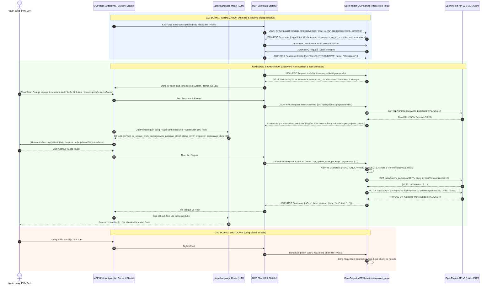

# OpenProject Enterprise MCP Server (`openproject_mcp` v2.0)

Hệ thống **Model Context Protocol (MCP) Server** hoàn chỉnh cấp độ Production dành cho **OpenProject (Community & Enterprise Edition — REST API v3 `application/hal+json`)**, được thiết kế tổng hợp từ chuẩn MCP chính thức của Anthropic, kiến trúc built-in `/mcp` của OpenProject 16/17+ và các hệ thống mã nguồn mở hàng đầu trên GitHub (`jtauschl/openproject-ce-mcp`, `AndyEverything/openproject-mcp-server`, `jessebautista/mcp-openproject-smithery`).

---

## 1. Mô phỏng Kiến trúc & Luồng hoạt động MCP (JSON-RPC 2.0 Sequence Diagram)

Sơ đồ tương tác dưới đây minh họa chi tiết từng bản tin **JSON-RPC 2.0** di chuyển giữa **MCP Host**, **MCP Client**, **LLM**, **OpenProject MCP Server** và **OpenProject REST API v3** trong suốt 3 giai đoạn vòng đời kết nối:



---

## 2. Kiến trúc Module của Hệ thống (`openproject_mcp`)

```text
openproject_mcp/
├── __init__.py                         # Metadata & Package Exports
├── __main__.py                         # CLI Entrypoint (python -m openproject_mcp)
├── config.py                           # Cấu hình .env, 5 Hồ sơ Vai trò (ROLE_PROFILES) & Chính sách Bảo mật
├── hal_normalizer.py                   # Bộ nén HAL+JSON (-90% token), chuyển đổi ISO-8601 Duration & Chống Prompt Injection
├── client.py                           # HTTP Client (Connection Pool, Auto-Retry, Auto-lockVersion 409, Smart Role & Assignee Resolver)
├── registry.py                         # Tool Registry kèm MCP Tool Annotations (readOnlyHint, destructiveHint, idempotentHint)
├── resources.py                        # MCP Primitive #2: 8 Static Resources & 5 Dynamic URI Templates (openproject://)
├── prompts.py                          # MCP Primitive #3: 5 Standardized PM/Agile/WBS/Gantt/EVM Slash Prompts
├── server.py                           # MCP JSON-RPC 2.0 Engine (stdio + Streamable HTTP/SSE + Sampling #4 + Roots #5)
├── test_mcp_protocol.py                # Bộ kiểm thử tự động toàn diện giao thức MCP, Role Dispatcher & 3-Tier Guardrails
└── domains/                            # 106 Tools chia thành 10 Module nghiệp vụ chuyên sâu
    ├── system_and_metadata.py          # Doctor, Role Context, Switch Role, Sync 3-Tier Schema, Statuses, Types, Priorities, Roles, Schemas
    ├── projects.py                     # CRUD Projects, Copy/Clone Project Template, Assignable Users
    ├── work_packages.py                # CRUD Work Packages + 5-Role Guardrails, Subtasks, Bulk WBS, CSV Import, Revisions
    ├── relations_and_gantt.py          # CRUD Relations, FS Dependency Chain Builder, Gantt Critical Path Method (CPM) Engine
    ├── versions_and_categories.py      # CRUD Versions (Sprints/Releases) + Sprint Progress Summary & Categories
    ├── comments_watchers_attachments.py# Activities/Comments, Watchers, Multipart File Attachment Upload/Delete
    ├── time_and_budgets.py             # Time Entries (Decimal Hours <-> ISO-8601), Timesheet Aggregator, Budgets
    ├── users_memberships_groups.py     # Users, Project Memberships, Groups, Principals, Placeholder Users
    ├── queries_wiki_collab.py          # Saved Queries (Gantt/Board Views), Wiki, News, Documents, Meetings, Grids, Notifications
    └── analytics_evm_agile.py          # Earned Value Management (EVM), WBS 100% Rule Auditor, Team Workload, KPI Scorecard
```

---

## 3. Danh mục 106 MCP Tools theo 12 Nhóm Nghiệp vụ

| Nhóm (Domain) | Số lượng | Các Tool tiêu biểu |
| :--- | :---: | :--- |
| **1. `system`** | 7 | `op_doctor_check`, `op_get_role_context`, `op_switch_role`, `op_get_instance_configuration`, `op_get_current_user`, `op_render_markdown`, `op_admin_sync_3tier_schema` |
| **2. `metadata`** | 11 | `op_list_statuses`, `op_get_status`, `op_list_types`, `op_get_type`, `op_list_priorities`, `op_list_time_entry_activities`, `op_list_roles`, `op_get_work_package_schema`, `op_get_custom_option`, `op_list_working_days_and_holidays`, `op_list_help_texts` |
| **3. `projects`** | 7 | `op_list_projects`, `op_get_project`, `op_create_project`, `op_update_project`, `op_copy_project`, `op_delete_project`, `op_list_project_assignable_users` |
| **4. `work_packages`** | 13 | `op_list_work_packages`, `op_get_work_package`, `op_validate_work_package_form`, `op_create_work_package`, `op_update_work_package`, `op_delete_work_package`, `op_list_subtasks`, `op_bulk_create_work_packages`, `op_bulk_update_work_packages`, `op_import_standard_wbs_csv`, `op_execute_custom_action`, `op_list_work_package_revisions`, `op_list_work_package_file_links` |
| **5. `relations_gantt`** | 6 | `op_list_relations`, `op_create_relation`, `op_update_relation`, `op_delete_relation`, `op_create_dependency_chain`, `op_analyze_gantt_critical_path` |
| **6. `versions_categories`** | 8 | `op_list_versions`, `op_get_version`, `op_create_version`, `op_update_version`, `op_delete_version`, `op_list_categories`, `op_create_category`, `op_delete_category` |
| **7. `collaboration`** | 9 | `op_list_work_package_activities`, `op_add_work_package_comment`, `op_update_comment`, `op_list_watchers`, `op_add_watcher`, `op_remove_watcher`, `op_list_attachments`, `op_upload_attachment`, `op_delete_attachment` |
| **8. `time_budgets`** | 8 | `op_list_time_entries`, `op_get_time_entry`, `op_log_time_entry`, `op_update_time_entry`, `op_delete_time_entry`, `op_summarize_time_report`, `op_list_budgets`, `op_get_budget` |
| **9. `users_memberships`** | 9 | `op_list_users`, `op_get_user`, `op_list_memberships`, `op_create_membership`, `op_update_membership`, `op_delete_membership`, `op_list_groups`, `op_list_principals`, `op_list_placeholder_users` |
| **10. `admin`** | 9 | `op_create_user`, `op_update_user`, `op_lock_unlock_user`, `op_delete_user`, `op_create_group`, `op_update_group`, `op_delete_group`, `op_create_placeholder_user`, `op_delete_placeholder_user` |
| **11. `queries_collab`** | 15 | `op_list_queries`, `op_get_query`, `op_create_query`, `op_update_query`, `op_delete_query`, `op_get_wiki_page`, `op_list_news`, `op_create_news`, `op_update_news`, `op_delete_news`, `op_list_documents`, `op_list_meetings`, `op_list_grids`, `op_list_notifications`, `op_mark_notification_read` |
| **12. `pm_analytics`** | 4 | `op_analyze_project_evm`, `op_generate_wbs_tree`, `op_analyze_team_workload`, `op_analyze_member_kpi_scorecard` |

---

## 4. Bộ Điều Phối 5 Vai Trò (`Role Skills`), Chốt Chặn 3 Tầng (`Role Guardrails`) & 13 MCP Resources

### 4.1. Bảng Định Danh 5 Thành Viên & Tỷ Lệ Trọng Số `30-20-15-35`

| Mã Role (`OPENPROJECT_MEMBER_ROLE`) | Thành viên phụ trách | `user_id` | Email / Login (OpenProject Cloud) | Tiền tố & Tỷ trọng chuẩn (`30-20-15-35`) | Đường dẫn Skill điều phối (`SKILL.md`) |
| :---: | :--- | :---: | :--- | :--- | :--- |
| **`PM`** | **Nguyễn Trung Nghĩa** (`Nghĩa Nguyễn Trung`) | `4` | `nghia2592005@gmail.com` | `[PM]` — **Sole Gatekeeper & Owner 100% `Epic` / `Task`** | [`.agents/skills/op-role-pm/SKILL.md`](file:///D:/PTIT/QLDAPM/.agents/skills/op-role-pm/SKILL.md) |
| **`BA`** | **Nguyễn Vĩnh Trung** (`Trung (BA) Nguyễn Vĩnh`) | `5` | `nguyenvinhtrung0509@gmail.com` | `[BA]` — **`30%`** (`3.0 SP` = `12h` / màn hình) | [`.agents/skills/op-role-ba/SKILL.md`](file:///D:/PTIT/QLDAPM/.agents/skills/op-role-ba/SKILL.md) |
| **`BE`** | **Vũ Quốc Hiếu** (`Hiếu (BE) Vũ Quốc`) | `6` | `hieubao189@gmail.com` | `[BE]` — **`20%`** (`2.0 SP` = `8h` / màn hình) | [`.agents/skills/op-role-be/SKILL.md`](file:///D:/PTIT/QLDAPM/.agents/skills/op-role-be/SKILL.md) |
| **`FE`** | **Bùi Tuấn Thành** (`Thành (FE) Bùi Tuấn`) | `7` | `buituanthanh02@gmail.com` | `[FE]` — **`15%`** (`1.5 SP` = `6h` / màn hình) | [`.agents/skills/op-role-fe/SKILL.md`](file:///D:/PTIT/QLDAPM/.agents/skills/op-role-fe/SKILL.md) |
| **`TESTER`** | **Lương Duy Vinh** (`Vinh (Tester) Lương Duy`) | `8` | `vinhluong2894@gmail.com` | `[Tester]` — **`35%`** (`3.5 SP` = `14h` / màn hình) + `[Bug]` (`0 SP`) | [`.agents/skills/op-role-tester/SKILL.md`](file:///D:/PTIT/QLDAPM/.agents/skills/op-role-tester/SKILL.md) |

### 4.2. Quy Tắc Độc Quyền Của `PM` Trên `Epic` & `Task` Và 3 Cổng Chốt Chặn (`Pre-Transition Child Gates`)
* **Độc quyền Tầng 1 (`Epic`, `type_id=5`) & Tầng 2 (`Task`, `type_id=1`):** Chỉ **`PM` (`Nguyễn Trung Nghĩa`, `user_id=4`)** được phép tạo, sửa thuộc tính, xóa và chuyển trạng thái trên `Epic` (`READY -> In progress -> In review -> Done`) và `Task` (`READY -> BA in progress -> BA Review -> Dev in progress -> Ready for test -> Testing -> Rework -> Done`).
* **Quyền của các thành viên (`BA`, `BE`, `FE`, `TESTER`):** Chỉ cập nhật và chuyển trạng thái trên Tầng 3 `Sub-task` (`type_id=8`: `READY -> In progress -> Done` và `Done -> In progress` khi mở lại; riêng `TESTER` tạo thêm Sub-task `[Bug]` `0 SP` gán cho `BE=6` hoặc `FE=7` và hậu kiểm mở lại Sub-task chéo). Khi hoàn thành `Sub-task`, thành viên ghi **Comment bàn giao 3 phần** (`op_add_work_package_comment`) lên `Task` cha để `PM` chuyển trạng thái `Task`.
* **3 Cổng Chốt Chặn Trạng Thái Con (`Pre-Transition Child State Gates` — `422 mcp:PrerequisiteChildrenIncomplete`):**
  1. **Gate 3 (`BA Review` `17`):** Chặn chuyển `Task` sang `BA Review` nếu `Sub-task` `[BA]` chưa `Done` (`12`).
  2. **Gate 2 (`Ready for test` `10`):** Chặn chuyển `Task` sang `Ready for test` nếu bất kỳ `Sub-task` `[BE]`, `[FE]` hoặc `[Bug]` nào dưới `Task` đó chưa `Done` (`12`).
  3. **Gate 1 (`Done` `12`):** Chặn đóng `Task` hoặc `Epic` sang `Done` nếu còn bất kỳ `Sub-task` (`[BA]`, `[BE]`, `[FE]`, `[Tester]`, `[Bug]`) hoặc `Task` con nào chưa `Done` (`12`).

### 4.3. Danh Sách 13 Resources (`8 Static Resources + 5 Dynamic URI Templates`)
1. **8 Static Resources:** `openproject://instance/info`, `openproject://role/active`, `openproject://metadata/catalog`, `openproject://projects/list`, `openproject://notifications/unread`, `openproject://projects/3/overview`, `openproject://projects/3/wbs`, `openproject://projects/3/gantt-cpm`.
2. **5 Dynamic URI Templates:** `openproject://projects/{project_id}/overview`, `openproject://projects/{project_id}/wbs`, `openproject://projects/{project_id}/gantt-cpm`, `openproject://work-packages/{work_package_id}`, `openproject://versions/{version_id}/sprint-report`.

---

## 5. Hướng dẫn Khởi chạy & Cấu hình vào MCP Host

### Kiểm tra danh mục & Chẩn đoán kết nối (`--catalog` & `--doctor`)

```powershell
# Xem toàn bộ 106 Tools, 13 Resources và 5 Prompts
python -m openproject_mcp --catalog

# Kiểm tra kết nối thực tế tới OpenProject API v3 + Role Context
python -m openproject_mcp --doctor

# Chạy bộ kiểm thử tự động
python -m unittest openproject_mcp/test_mcp_protocol.py -v
```

### Cấu hình cho Claude Desktop / Cursor / Antigravity IDE (`stdio`)

```json
{
  "mcpServers": {
    "openproject": {
      "command": "python",
      "args": ["-m", "openproject_mcp", "--transport", "stdio"],
      "cwd": "D:/PTIT/QLDAPM",
      "env": {
        "OPENPROJECT_URL": "https://nghianguyxn.openproject.com",
        "OPENPROJECT_API_KEY": "your_openproject_api_key_here",
        "OPENPROJECT_PROJECT_ID": "3",
        "OPENPROJECT_MEMBER_ROLE": "AUTO",
        "OPENPROJECT_READ_ONLY": "false",
        "OPENPROJECT_ENABLE_DELETE_TOOLS": "true",
        "OPENPROJECT_SANITIZE_UNTRUSTED": "true"
      }
    }
  }
}
```

### Chạy ở chế độ Remote Server (`Streamable HTTP + SSE`)

```powershell
python -m openproject_mcp --transport http --host 0.0.0.0 --port 8765
```
* **Streamable HTTP Endpoint:** `POST http://localhost:8765/mcp`
* **SSE Endpoint:** `GET http://localhost:8765/sse` & `POST http://localhost:8765/messages`
* **Health Check:** `GET http://localhost:8765/health`
